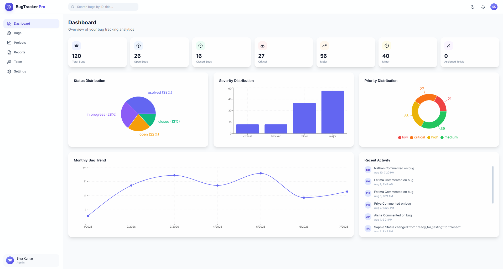
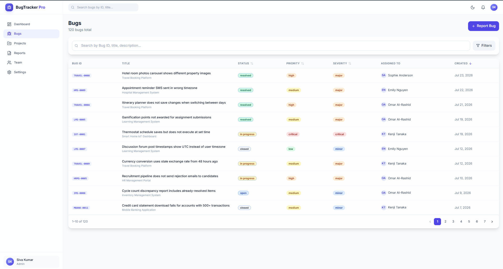
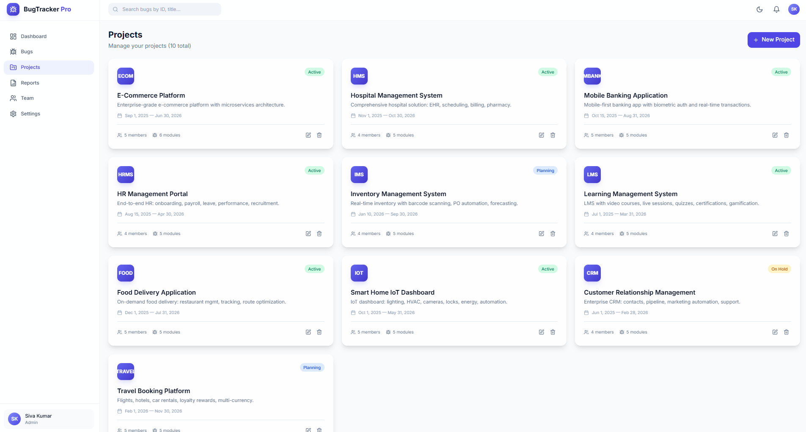
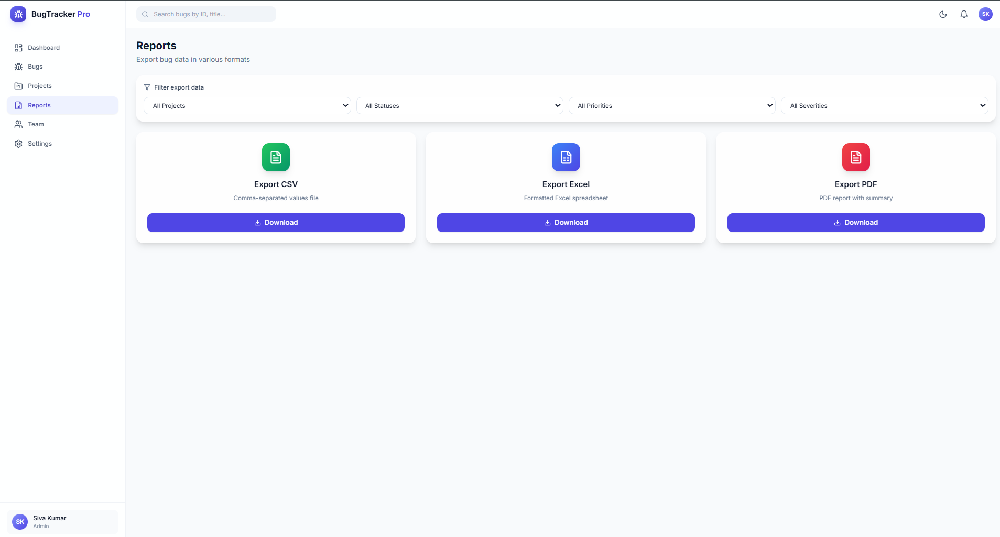
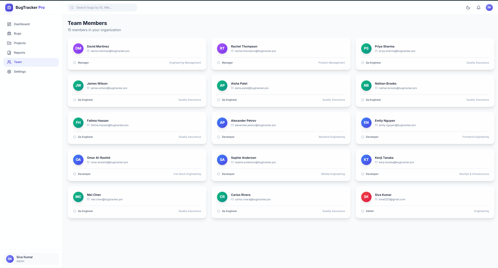
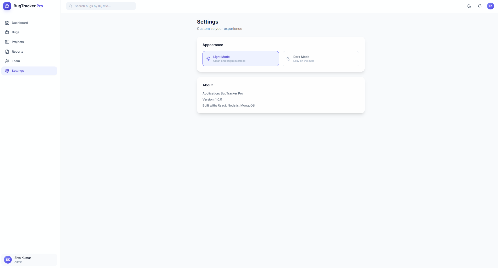

<p align="center">
  
</p>

<h1 align="center">BugTracker Pro</h1>

<p align="center">
  <strong>Enterprise Bug Tracking & QA Management Platform for Modern Engineering Teams</strong>
</p>

<p align="center">
  A modern full-stack application for tracking bugs, managing projects, collaborating with teams, and monitoring the complete software development lifecycle.
</p>

<p align="center">
  
  
  
  
  
  
</p>

<p align="center">
  
  
  
  
</p>

<p align="center">
  <a href="#-quick-start">Quick Start</a> •
  <a href="#-features">Features</a> •
  <a href="#-tech-stack">Tech Stack</a> •
  <a href="#-architecture">Architecture</a> •
  <a href="#-api-overview">API</a> •
  <a href="#-screenshots">Screenshots</a>
</p>

---

# 📋 Overview

**BugTracker Pro** is a modern full-stack bug tracking and project management platform built with the MERN stack. It simplifies the complete software defect lifecycle—from issue reporting and assignment to QA validation, resolution, and release—through a clean, responsive, and enterprise-inspired interface.

Unlike basic CRUD portfolio projects, BugTracker Pro demonstrates how real engineering teams organize bug reporting, collaboration, project management, analytics, and quality assurance within a single application.

### 🚀 Project Highlights

- 🐞 120 realistic seeded bugs across multiple enterprise projects
- 👥 Role-Based Access Control with Admin, Manager, Developer, and QA roles
- 📊 Interactive analytics dashboard with real-time insights
- 📁 Complete project and bug lifecycle management
- 📄 Export reports in CSV, Excel, and PDF formats
- ⚡ Zero-configuration development environment with automatic data seeding

# 🎯 Why BugTracker Pro?

Many portfolio projects demonstrate basic CRUD operations. BugTracker Pro goes further by simulating how engineering teams manage bugs, collaborate across roles, and track project progress in a real-world environment.

The project focuses on practical workflows, scalable architecture, and a professional user experience inspired by modern engineering platforms.

| Common Portfolio Limitation | How BugTracker Pro Stands Out |
|-----------------------------|-------------------------------|
| Simple CRUD demonstrations | Simulates a complete enterprise bug management workflow |
| Limited sample data | Includes realistic projects, bugs, comments, and activities |
| Minimal architecture | Structured using modular frontend and backend layers |
| Basic authentication | Secure role-based access with protected routes |
| Static dashboards | Interactive analytics with charts and real-time metrics |
| Few export options | Supports CSV, Excel, and PDF report generation |
| Basic UI | Modern responsive interface with dark mode and smooth animations |

---

## 🌟 What Makes It Different?

- 🐞 Complete bug lifecycle management
- 👥 Multi-role access control (Admin, Manager, Developer, QA)
- 📊 Analytics dashboard with business insights
- 📁 Project management and reporting
- 📤 Professional export capabilities
- 🔐 Security-focused backend architecture
- 📱 Responsive interface across all devices
- ⚡ Built using modern MERN technologies

---

> **Designed to reflect real software engineering workflows rather than a simple demonstration project.**

# 🚀 Key Features

BugTracker Pro provides a complete set of tools for managing bugs, projects, team collaboration, and software quality assurance within a single platform.

---

## 🔐 Authentication & User Management

- Secure JWT-based authentication
- Role-Based Access Control (Admin, Manager, Developer, QA Engineer)
- Protected routes with permission-based access
- Rate-limited login to reduce brute-force attempts
- User profile management with avatar support

---

## 📊 Analytics Dashboard

Monitor project health with real-time analytics.

### Dashboard Includes

- 📈 Total, Open, Closed & Assigned Bugs
- 🚨 Critical, Major & Minor Issue Tracking
- 📊 Interactive Charts & Reports
- 📝 Recent Activity Timeline
- 👤 Role-specific dashboard views

---

## 🐞 Bug Management

Efficiently manage the complete bug lifecycle.

- Auto-generated Bug IDs
- Create, Edit & Delete Bugs
- Assign Developers & QA Engineers
- Priority & Severity Management
- Workflow Status Tracking
- Screenshot Attachments
- Activity History
- Advanced Search & Filters

---

## 💬 Team Collaboration

Designed for collaborative engineering teams.

- Threaded Comments
- Edit & Delete Own Comments
- Activity Timeline
- Timestamp Tracking
- Team Communication History

---

## 📁 Project Management

Manage multiple software projects with ease.

- Create & Manage Projects
- Module-based Organization
- Project-specific Bug Tracking
- Team Assignment
- Safe Project Deletion Validation

---

## 📤 Reports & Export

Generate reports for analysis and documentation.

Supported formats:

- 📄 PDF
- 📊 Excel (.xlsx)
- 📑 CSV

Exports can be filtered by:

- Project
- Status
- Priority
- Severity

---

## 🎨 User Experience

Built with a modern design system for better usability.

- 🌙 Dark & Light Theme
- 📱 Fully Responsive Layout
- ⚡ Smooth Page Transitions
- 🔔 Toast Notifications
- 💀 Skeleton Loading States
- ♿ Accessibility Support

---

## ⭐ Highlights

| Feature | Status |
|---------|:------:|
| Authentication | ✅ |
| Bug Tracking | ✅ |
| Project Management | ✅ |
| Dashboard Analytics | ✅ |
| Report Export | ✅ |
| Role-Based Access | ✅ |
| Responsive UI | ✅ |
| Dark Mode | ✅ |
| File Uploads | ✅ |

# 📸 Application Preview

Take a quick tour of BugTracker Pro through the screenshots below. The interface is designed to deliver a clean, responsive, and enterprise-grade user experience.

---

## 📊 Dashboard

A centralized dashboard providing project insights, bug statistics, analytics, and recent team activity.



---

## 🐞 Bug Management

Create, assign, update, and monitor bugs with advanced filtering, priority management, and workflow tracking.



---

## 📁 Project Management

Organize projects, assign teams, and manage modules from a single workspace.



---

## 📈 Reports

Generate professional reports and export data in PDF, Excel, or CSV formats.



---

## 👥 Team Management

Manage users, roles, and collaboration across development and QA teams.



---

## ⚙️ Settings

Customize themes, preferences, and application settings for a personalized experience.



---

# ✨ UI Highlights

- 🎨 Modern glassmorphism-inspired interface
- 🌙 Dark & Light mode support
- 📱 Responsive across desktop, tablet, and mobile
- ⚡ Smooth page transitions and animations
- ♿ Accessibility-focused design
- 🚀 Optimized for performance and usability

# 🛠️ Tech Stack

BugTracker Pro is built using a modern MERN stack with carefully selected libraries that deliver performance, scalability, security, and an excellent developer experience.

---

## ⚛️ Frontend

| Technology | Purpose |
|------------|---------|
| React 19 | Component-based user interface development |
| Vite 5 | Fast development server with optimized production builds |
| Tailwind CSS | Utility-first styling and responsive layouts |
| Framer Motion | Smooth animations and interactive transitions |
| React Router | Client-side routing and protected navigation |
| React Hook Form | Form management and validation |
| Recharts | Interactive analytics and dashboard visualizations |
| Axios | API communication with interceptors |
| Lucide React | Lightweight SVG icon library |
| date-fns | Date formatting and utility functions |

---

## 🛠 Backend

| Technology | Purpose |
|------------|---------|
| Node.js 20 | JavaScript runtime environment |
| Express.js | REST API development and middleware handling |
| MongoDB + Mongoose | Document database with schema validation |
| JWT | Secure authentication and authorization |
| bcryptjs | Password hashing and encryption |
| Helmet | Security-focused HTTP headers |
| express-rate-limit | API rate limiting and brute-force protection |
| Multer | File upload handling |
| ExcelJS | Excel report generation |
| PDFKit | PDF report generation |
| Compression | Response compression for improved performance |
| mongodb-memory-server | In-memory database for local development |

---

## ⚡ Development Environment

| Requirement | Recommended Version |
|-------------|---------------------|
| Node.js | 18+ |
| npm | Latest Stable |
| MongoDB | 8+ |
| Git | Latest |
| VS Code | Latest |

---

## 🎯 Why This Stack?

- ⚡ High-performance development workflow
- 🔒 Secure authentication and backend architecture
- 📦 Scalable MERN application structure
- 📱 Responsive and accessible UI
- 🎨 Modern design system with Tailwind CSS
- 🚀 Optimized build performance using Vite
- 📊 Powerful analytics and reporting capabilities
- ♻️ Easy maintenance and future scalability

---

## 🚀 Key Advantages

- Modern full-stack architecture
- Enterprise-ready technology stack
- Fast local development
- Optimized production builds
- Modular and reusable codebase
- Strong community and long-term support

# 🏗️ Architecture

BugTracker Pro follows a scalable MERN architecture with a clear separation between the frontend, backend, and database layers. Each layer has a dedicated responsibility, making the application easier to maintain, extend, and deploy.

---

## 📐 System Architecture

```text
                    ┌──────────────────────────┐
                    │        Frontend          │
                    │      React + Vite SPA    │
                    └────────────┬─────────────┘
                                 │
                   HTTP / REST API (JSON)
                                 │
                    ┌────────────▼─────────────┐
                    │        Express API       │
                    │ Authentication • Routes  │
                    │ Controllers • Services   │
                    └────────────┬─────────────┘
                                 │
                          Mongoose ODM
                                 │
                    ┌────────────▼─────────────┐
                    │         MongoDB          │
                    │ Users • Projects • Bugs  │
                    │ Comments • Activities    │
                    └──────────────────────────┘
```

---

## 🧩 Architecture Layers

### 🎨 Frontend

The frontend is built with React and Vite, providing a responsive and interactive single-page application.

Responsibilities include:

- User Interface
- Protected Routes
- API Communication
- Theme Management
- Form Validation
- Dashboard Visualization

---

### ⚙️ Backend

The Express backend handles business logic, authentication, validation, and secure API endpoints.

Core responsibilities:

- Authentication
- Authorization
- Bug Management
- Project Management
- Report Generation
- File Upload Processing

---

### 🗄️ Database

MongoDB stores all application data using structured Mongoose models.

Collections include:

- Users
- Projects
- Bugs
- Comments
- Activities

---

## 🔄 Request Flow

```text
User
   │
   ▼
React Frontend
   │
   ▼
Express REST API
   │
   ▼
Business Logic
   │
   ▼
MongoDB Database
   │
   ▼
Response → Frontend
```

---

## ⭐ Architecture Highlights

- 🧩 Modular project structure
- 🔒 Secure authentication flow
- ⚡ Fast REST API communication
- 📦 Scalable service-based architecture
- 💾 MongoDB document storage
- 📱 Responsive frontend
- 🚀 Optimized for production deployment

---

## 🎯 Design Goals

- Maintainable codebase
- Clear separation of concerns
- Easy scalability
- Better performance
- Enterprise-ready architecture
- Clean development workflow

# 📂 Project Structure

BugTracker Pro follows a clean and modular project structure that separates the frontend and backend into independent layers, making development, testing, and maintenance much easier.

---

## 📁 Directory Layout

```text
bugtracker-pro/
│
├── 📁 backend/
│   ├── config/            # Database & application configuration
│   ├── controllers/       # Request handlers
│   ├── middleware/        # Authentication & validation
│   ├── models/            # MongoDB schemas
│   ├── routes/            # REST API routes
│   ├── services/          # Business logic
│   ├── utils/             # Helper utilities & seed scripts
│   ├── uploads/           # Uploaded attachments
│   ├── server.js
│   └── .env.example
│
├── 📁 frontend/
│   ├── public/
│   └── src/
│       ├── assets/
│       ├── components/
│       ├── context/
│       ├── hooks/
│       ├── layouts/
│       ├── pages/
│       ├── services/
│       ├── styles/
│       ├── App.jsx
│       └── main.jsx
│
├── 📁 docs/
│   └── QA_AUDIT_REPORT.md
│
├── README.md
└── LICENSE
```

---

# 📋 Folder Responsibilities

| Folder | Description |
|---------|-------------|
| 📁 **backend** | Handles APIs, authentication, business logic, and database operations. |
| 📁 **frontend** | Contains the complete React application and user interface. |
| 📁 **controllers** | Processes incoming requests and returns responses. |
| 📁 **models** | Defines MongoDB collections using Mongoose schemas. |
| 📁 **routes** | Registers and organizes API endpoints. |
| 📁 **services** | Contains reusable business logic independent of controllers. |
| 📁 **middleware** | Authentication, validation, upload handling, and security middleware. |
| 📁 **utils** | Utility functions, helper methods, and data seeding scripts. |
| 📁 **components** | Reusable UI components shared across multiple pages. |
| 📁 **pages** | Main application screens and route-level components. |
| 📁 **docs** | Project documentation and QA reports. |

---

# 🏛️ Project Design Principles

- 🧩 Modular architecture
- ♻️ Reusable components
- 📦 Clear separation of concerns
- 🚀 Easy scalability
- 🔒 Secure backend design
- 📱 Responsive frontend
- ⚡ Optimized developer experience

---

## ⭐ Benefits

- Easy to understand
- Beginner-friendly structure
- Faster onboarding
- Better maintainability
- Independent frontend & backend
- Scalable for future modules

# 🚀 Quick Start

Get BugTracker Pro running on your local machine in just a few minutes.

---

## 📋 Prerequisites

Before you begin, ensure the following tools are installed:

- Node.js 18 or later
- npm or Yarn
- Git

> 💡 MongoDB installation is optional during development. The project automatically uses an in-memory MongoDB instance when a local database is unavailable.

---

## 📥 Installation

### 1️⃣ Clone the Repository

```bash
git clone https://github.com/sivaprakashtech/BugTracker-Pro.git
cd bugtracker-pro
```

---

### 2️⃣ Backend Setup

```bash
cd backend
npm install
cp .env.example .env
```

---

### 3️⃣ Frontend Setup

```bash
cd ../frontend
npm install
```

---

## ▶️ Run the Application

Open two terminal windows.

### Terminal 1 — Backend

```bash
cd backend
npm run dev
```

### Terminal 2 — Frontend

```bash
cd frontend
npm run dev
```

---

## 🌐 Open the Application

Frontend

```text
http://localhost:5173
```

Backend API

```text
http://localhost:5000
```

---

## ⚡ Automatic Demo Data

On the first startup the application automatically prepares demo data including:

- 👥 User Accounts
- 📁 Projects
- 🐞 Bugs
- 💬 Comments
- 📊 Activity Logs

No manual database setup or data import is required.

---

## 📦 Setup Workflow

```text
Clone Repository
        │
        ▼
Install Backend
        │
        ▼
Install Frontend
        │
        ▼
Start Backend
        │
        ▼
Start Frontend
        │
        ▼
Open Browser
        │
        ▼
Start Exploring 🚀
```

---

## ✅ Ready to Go!

Once both servers are running, you're ready to explore BugTracker Pro, create projects, manage bugs, collaborate with your team, and generate reports.

# 🔑 Environment Variables

BugTracker Pro uses environment variables to configure the backend server, database connection, authentication, and frontend API endpoint.

---

## 🖥️ Backend Configuration

Create a `.env` file inside the **backend** directory.

```env
PORT=5000
MONGO_URI=mongodb://localhost:27017/bugtracker-pro
JWT_SECRET=your_secret_key_minimum_32_characters
JWT_EXPIRE=7d
NODE_ENV=development
CLIENT_URL=http://localhost:5173
```

---

## 🌐 Frontend Configuration

Create a `.env` file inside the **frontend** directory.

```env
VITE_API_URL=http://localhost:5000/api
```

---

## 💡 Development Notes

- MongoDB installation is optional during local development.
- If no MongoDB instance is detected, the application automatically starts with an in-memory database.
- Environment variables can be customized for production deployments.

---

# 👤 Demo Credentials

The application comes with pre-configured demo accounts for testing different user roles.

| Role | Email | Password |
|------|-------|----------|
| 👑 Admin | `siva0225@gmail.com` | `1231231234` |
| 📋 Manager | `rachel.thompson@bugtracker.pro` | `1231231234` |
| 📋 Manager | `david.martinez@bugtracker.pro` | `1231231234` |
| 💻 Developer | `alexander.petrov@bugtracker.pro` | `1231231234` |
| 🧪 QA Engineer | `priya.sharma@bugtracker.pro` | `1231231234` |

> **Note:** All seeded demo accounts use the same password for development purposes.

# 📡 API Overview

BugTracker Pro exposes a RESTful API for authentication, project management, bug tracking, reporting, and team collaboration.

All protected endpoints require a valid JWT access token.

---

## 🔐 Authentication

| Method | Endpoint | Description | Access |
|--------|----------|-------------|--------|
| POST | `/api/auth/register` | Register a new user | Public |
| POST | `/api/auth/login` | Authenticate and receive JWT | Public |
| GET | `/api/auth/profile` | Retrieve logged-in user profile | Protected |
| PUT | `/api/auth/profile` | Update profile information | Protected |
| PUT | `/api/auth/change-password` | Change account password | Protected |
| GET | `/api/auth/users` | Retrieve all users | Protected |
| PUT | `/api/auth/users/:id/role` | Update user role | Admin |

---

## 🐞 Bug Management

| Method | Endpoint | Description | Access |
|--------|----------|-------------|--------|
| GET | `/api/bugs` | List all bugs | Protected |
| GET | `/api/bugs/dashboard` | Dashboard statistics | Protected |
| GET | `/api/bugs/:id` | Get bug details | Protected |
| GET | `/api/bugs/:id/activity` | View activity timeline | Protected |
| POST | `/api/bugs` | Create a new bug | Protected |
| PUT | `/api/bugs/:id` | Update bug details | Protected |
| PATCH | `/api/bugs/:id/status` | Update bug status | Protected |
| DELETE | `/api/bugs/:id` | Delete a bug | Admin / Manager |
| DELETE | `/api/bugs/:id/screenshots/:sid` | Remove screenshot | Protected |

---

## 📁 Project Management

| Method | Endpoint | Description | Access |
|--------|----------|-------------|--------|
| GET | `/api/projects` | Retrieve all projects | Protected |
| POST | `/api/projects` | Create a project | Protected |
| PUT | `/api/projects/:id` | Update project details | Protected |
| DELETE | `/api/projects/:id` | Delete a project | Admin / Manager |

---

## 💬 Comments

| Method | Endpoint | Description | Access |
|--------|----------|-------------|--------|
| GET | `/api/comments/:bugId` | Fetch comments for a bug | Protected |
| POST | `/api/comments/:bugId` | Add a new comment | Protected |
| PUT | `/api/comments/:id` | Edit a comment | Author |
| DELETE | `/api/comments/:id` | Delete a comment | Author / Admin |

---

## 📊 Reports

| Method | Endpoint | Description | Access |
|--------|----------|-------------|--------|
| GET | `/api/reports/csv` | Export report as CSV | Protected |
| GET | `/api/reports/excel` | Export report as Excel | Protected |
| GET | `/api/reports/pdf` | Export report as PDF | Protected |

---

## 🔒 Authentication Flow

```text
Login
   │
   ▼
JWT Token Generated
   │
   ▼
Token Stored
   │
   ▼
Authorization Header
   │
   ▼
Protected API Access
```

---

## 💡 API Highlights

- RESTful API architecture
- JWT-based authentication
- Role-based authorization
- Consistent JSON responses
- Secure protected endpoints
- Modular route organization
- Easy integration with frontend applications

# 🔒 Security & Performance

BugTracker Pro is built with security, reliability, and performance in mind. The application follows modern backend practices to protect user data, secure API access, and deliver a smooth user experience.

---

# 🛡️ Security Features

| Feature | Description |
|---------|-------------|
| 🔐 Password Security | Passwords are securely hashed using **bcryptjs** with 12 salt rounds. |
| 🎫 JWT Authentication | Secure token-based authentication with configurable expiration. |
| 🚦 Rate Limiting | Protects authentication endpoints against brute-force attacks. |
| 🪖 HTTP Security Headers | Powered by **Helmet** to improve application security. |
| 🌐 CORS Protection | Restricts unauthorized cross-origin requests. |
| ✅ Input Validation | Server-side validation for all incoming requests. |
| 👥 Role-Based Authorization | API access is restricted based on user roles. |
| 🛑 Injection Protection | Whitelisted sorting and validated query parameters. |
| 📄 Secure File Upload | File type and size validation before upload. |
| 🔒 Data Integrity | Protected project deletion and atomic database operations. |

---

# ⚡ Performance Optimizations

Performance has been optimized to provide a responsive experience even with large datasets.

| Optimization | Benefit |
|-------------|---------|
| ⚡ React Lazy Loading | Loads pages only when required. |
| 📦 Code Splitting | Smaller JavaScript bundles for faster loading. |
| 🗜️ Gzip Compression | Reduces API response sizes. |
| 💾 Browser Caching | Improves loading performance for static assets. |
| 🔄 API Retry Strategy | Automatically retries failed GET requests. |
| ⏱️ Debounced Search | Minimizes unnecessary API calls while searching. |
| 💀 Skeleton Loaders | Improves perceived loading speed. |
| 🚀 Optimized Build | Vite generates highly optimized production assets. |

---

# 📊 Reliability Highlights

- 🔒 Secure authentication flow
- 🚀 Optimized API performance
- 📦 Modular backend architecture
- ⚡ Fast frontend rendering
- 💾 Efficient database access
- 📱 Responsive across all devices
- 🛡️ Production-ready security practices

---

# 🎯 Why It Matters

BugTracker Pro is designed to simulate how enterprise applications balance security, performance, and maintainability. These optimizations help deliver a fast, reliable, and scalable experience for both developers and QA teams.

# 🧪 Quality Assurance

BugTracker Pro was developed with a structured quality assurance workflow to ensure reliability, security, and a consistent user experience throughout the application.

---

## ✅ QA Overview

The project includes a dedicated QA audit report covering functionality, security, validation, usability, and performance.

### QA Coverage

| Category | Status |
|----------|:------:|
| 🔴 Critical Issues | ✅ Resolved |
| 🟠 High Priority | ✅ Resolved |
| 🟡 Medium Priority | ⚠️ Mostly Resolved |
| 🔵 Low Priority | 📋 Scheduled for Future Improvements |

---

## ✔ QA Validation Includes

- Functional Testing
- Authentication Testing
- Role-Based Access Verification
- API Validation
- Form Validation
- Error Handling
- File Upload Testing
- UI & Responsive Testing
- Dashboard Verification
- Report Export Validation

---

## 📄 QA Documentation

A complete QA audit is available inside the project documentation.

```text
docs/
└── QA_AUDIT_REPORT.md
```

The report documents identified issues, applied fixes, validation results, and recommendations for future improvements.

---

# 🚀 Deployment

BugTracker Pro can be deployed using modern cloud platforms with minimal configuration.

---

## 🌐 Frontend Deployment

Recommended Platform

- Vercel

```bash
cd frontend
npm run build
```

Deploy the generated **dist/** folder.

---

## ⚙ Backend Deployment

Recommended Platform

- Render

Configuration:

- Build Command

```bash
npm install
```

- Start Command

```bash
node server.js
```

Configure the required environment variables from the Render dashboard before deployment.

---

## 🗄 Database Deployment

Recommended Platform

- MongoDB Atlas

Deployment Steps

1. Create a free cluster.
2. Copy the MongoDB connection string.
3. Update the `MONGO_URI` environment variable.
4. Restart the backend server.

---

## 📦 Production Checklist

Before deploying, verify the following:

- ✅ Environment variables configured
- ✅ Production database connected
- ✅ JWT secret updated
- ✅ Build completed successfully
- ✅ API endpoints verified
- ✅ CORS configured correctly
- ✅ File uploads tested

---

## 🎯 Deployment Highlights

- Frontend optimized with Vite
- Secure Express backend
- MongoDB Atlas compatible
- Ready for cloud deployment
- Production-ready architecture

# 🔮 Future Roadmap

BugTracker Pro will continue to evolve with new features, better collaboration tools, and enhanced developer productivity.

---

## 🚀 Planned Features

- [ ] Real-time notifications using WebSockets
- [ ] Drag-and-drop Kanban board
- [ ] Email notifications
- [ ] GitHub & GitLab integration
- [ ] Sprint planning module
- [ ] Time tracking
- [ ] AI-powered bug classification
- [ ] End-to-end automation testing
- [ ] Docker support
- [ ] CI/CD with GitHub Actions

---

## 🎯 Long-Term Vision

The goal of BugTracker Pro is to become a complete bug tracking and QA management platform that demonstrates enterprise-grade software engineering practices while remaining easy to learn and extend.

Future releases will focus on:

- Better collaboration
- Performance improvements
- Advanced reporting
- AI-assisted workflows
- Cloud-native deployment
- Accessibility enhancements

---

# 🤝 Contributing

Contributions are always welcome.

If you'd like to improve BugTracker Pro:

1. Fork this repository.
2. Create a feature branch.

```bash
git checkout -b feature/your-feature
```

3. Commit your changes.

```bash
git commit -m "feat: add your feature"
```

4. Push your branch.

```bash
git push origin feature/your-feature
```

5. Open a Pull Request.

---

## 📋 Contribution Guidelines

Before submitting a Pull Request, please ensure:

- Code follows the existing project structure.
- New features include appropriate documentation.
- Existing functionality is not affected.
- Commit messages are meaningful.
- Code has been tested before submission.

---

# 📄 License

BugTracker Pro is licensed under the **MIT License**.

You are free to use, modify, distribute, and build upon this project in accordance with the terms of the license.

See the **LICENSE** file for complete details.

---

# 👨‍💻 Author

### Siva Prakash P

QA Engineer • Full Stack Developer • Open Source Enthusiast

Passionate about building scalable web applications, enterprise dashboards, testing platforms, and developer productivity tools.

---

## 🌐 Connect

- 💼 GitHub: https://github.com/sivaprakashtech
- 📧 Email: siva0225@gmail.com

---

# ❤️ Acknowledgements

Special thanks to the amazing open-source community behind:

- React
- Node.js
- Express.js
- MongoDB
- Tailwind CSS
- Vite
- Framer Motion
- Recharts

Their contributions make projects like BugTracker Pro possible.

---

<div align="center">

## ⭐ Support the Project

If you found this project helpful,

⭐ Star the repository

🍴 Fork the project

💡 Share your feedback

🤝 Contribute new ideas

Every contribution helps BugTracker Pro grow.

---

### 🚀 Track • Manage • Resolve • Deliver

Built with ❤️ by **Siva Prakash P**

</div>
